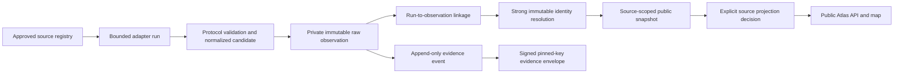

# Nooscape live data and ingestion architecture

> **Implemented status — 2026-10-08:** Nooscape operates a read-only, provenance-first production index. It has 58 source-scoped public Tier 2 / unverified records and an aggregate-only census context surface. It does not execute agent tools, use discovered credentials, make payments, or crawl arbitrary URLs.

## Implemented production data flow

The source registry is the only permitted ingress boundary. A source records its hostname/endpoint scope, protocol, lifecycle state, execution policy, cadence, and reviewer decisions. The browser never supplies an arbitrary ingestion URL.

## Identity and public projection

Nooscape does **not** merge agents by display name, handle, logo, or similarity.

| Source class | Immutable identity anchor | Public projection rule |
|---|---|---|
| A2A AgentCard | AgentCard URL | Snapshot comes from the exact retained observation. |
| Catalog | `sourceId:externalRecordId` | Catalog identity is source scoped; advertised endpoints remain assertions. |
| Solana registry | Mint address | Mint/authority/A2A metadata is asserted unless separately verified. |

Handles derive from the immutable identity plus a short digest. A potential merge must enter `identity_merge_reviews`; it cannot silently rewrite an existing record. Public record queries read `agent_public_snapshots` that are backed by an explicit `source_projection_decision`, rather than mutable global `agents` fields.

## Persistence model

| Table group | Purpose |
|---|---|
| `ingestion_sources`, `ingestion_runs`, `ingestion_worker_config` | Source lifecycle, execution policy, cadence, and append-only run audit. |
| `source_observations`, `source_observation_runs` | Retained source payload metadata plus each run linkage. |
| `agents`, `agent_identities`, `agent_endpoints` | Stable internal profile and strong source-derived identity anchors. |
| `agent_public_snapshots`, `source_projection_decisions` | Public-safe source-scoped display data and explicit publication gate. |
| `evidence_events` | Append-only observation evidence used to seal public envelopes. |
| `publisher_*`, `domain_verification_*`, `identity_merge_reviews` | Consent-gated trust policies, conflict review, and lifecycle audit. |

Raw source bytes remain in private RustFS Object Lock storage. The relational database stores the private-object reference, digest, validation result, normalized projection data, and timing metadata. The browser receives neither raw bytes nor object keys nor credentials.

## Evidence verification

Persisted public records produce an Ed25519-signed evidence envelope containing a canonical payload and SHA-256 digest. Public verification requires all of the following:

1. canonical payload digest match;
2. valid Ed25519 signature;
3. embedded envelope key agreement; and
4. match to the currently configured Nooscape relay public key **and** relay key ID.

The public relay-key manifest is served at `/.well-known/nooscape-keys.json`. It is built from the signing key at request time and lists the retired and revoked keys too ([evidence-key-rotation.md](./evidence-key-rotation.md)). A packet signed by a key that is not in it fails Nooscape verification even if its own signature is mathematically valid. (Until 2026-10-17 illustrative seed envelopes used a separate signer; the demo atlas is deleted.)

## Bounded adapters and execution policy

| Protocol | Current execution policy | Boundary |
|---|---|---|
| `a2a` | Scheduled or manual after source approval | One approved AgentCard resource; no tool or service invocation. |
| `catalog` | Scheduled or manual after source approval | Bounded approved catalog snapshot; no advertised endpoint dereference. |
| `census` | Scheduled or manual after source approval | Aggregate context only; no individual profile creation. |
| `solana_registry` | **Manual only** | Fixed bounded Metaplex page; no chain RPC, wallet call, or A2A invocation. |

The worker runs at most one due source per tick and uses database claims to enforce a global 15-minute interval. It must reject `solana_registry` sources.

## Security and quality requirements

- Enforce HTTPS, approved hostname boundaries, response-size/time caps, redirect restrictions, and SSRF protections.
- Parse metadata with versioned validation; preserve invalid/partial findings rather than inventing a passing record.
- Retain before projection. Check content digest and governance-retention state before any public decision.
- Never execute a discovered endpoint, instruction, tool, JavaScript bundle, or transaction.
- Never treat source-reported owner, signed, authority, domain, `verifiedAt`, or reputation fields as Nooscape verification.
- Keep operator credentials, DB credentials, S3 credentials, and signing private keys server-only and outside source control.

## UI scale contract

The Atlas may search the full public index, but the animated field and Deep Space view must use deterministic level-of-detail direct-node limits and semantic clusters. Do not reintroduce one DOM/SVG node or connection per indexed record. Public counts and trust filters are derived from live records, while illustrative seeds remain visibly separate.

## Next architecture changes

Any additional protocol or source requires a dedicated design/approval record that specifies the exact endpoint or chain coordinates, source terms, request cap, parser schema, identity anchor, raw-evidence contract, retained-evidence review, and public-projection policy. In particular, do not activate SATI, Robinhood/ERC-8004, Arc, QuickNode, x402scan, or a DAS/on-chain Metaplex cross-check from this architecture document alone.
